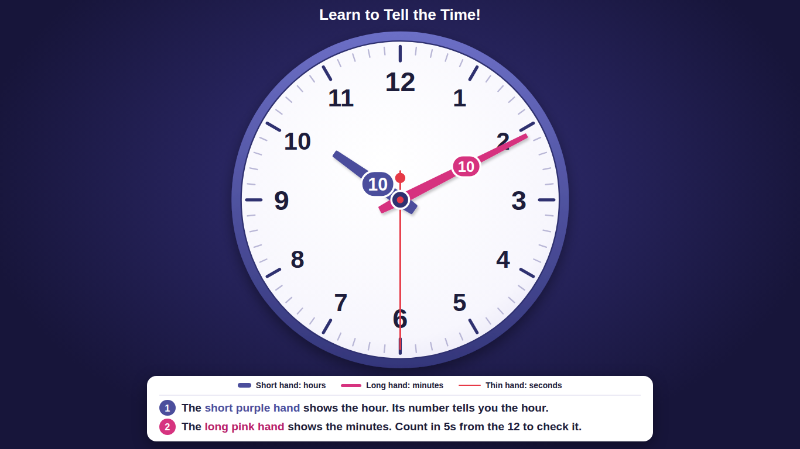
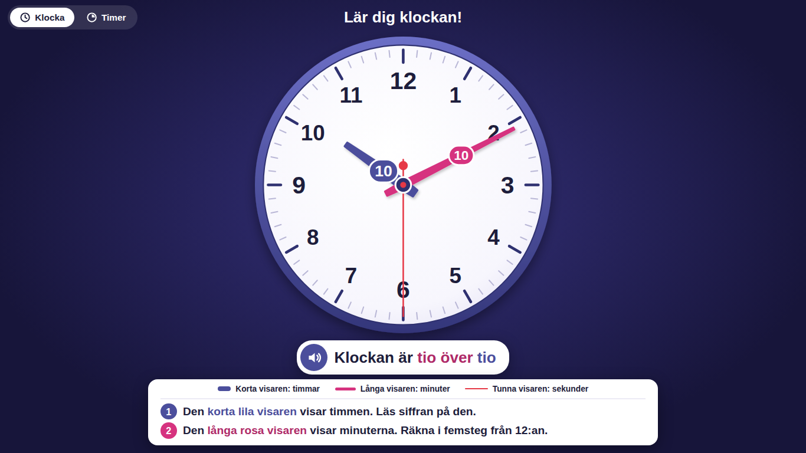

# Learn to Tell the Time

A free analogue clock that helps students learn to tell the time.

Each hand carries its own number. The short hand shows the hour and the long hand shows the minutes, so students can read the hands and check their answer at the same time. Two simple instructions underneath guide them through it, step by step.



## Why this exists

Reading an analogue clock is hard to learn because the hands do not tell you what they mean. This clock bridges that gap. Students see where each hand points and see the matching number right on the hand, so the link between the two clicks into place. Over time they rely on the numbers less, and teachers can switch the numbers off completely for practice.

It was built for school classrooms: for display on Chromebooks running in kiosk mode, and for embedding in a Google Site.

## Features

* A live analogue clock with hour, minute and second hands that move like a real clock.
* A number badge on the middle of the hour hand and the minute hand. The badges always read the right way up and never cover each other or the numbers on the face.
* A colour key and two short instructions, in high contrast colours that are easy to read from across a room.
* English and Swedish versions.
* One single HTML file per language with no dependencies. No web fonts, no libraries, no images and no internet connection needed.
* Fills any screen, from a small embed to a large display. On short screens the extras step aside so the clock stays big.
* Screen reader support. The clock announces the time once a minute.

## Languages

| Language | File | Notes |
| --- | --- | --- |
| English | `index.html` | The main version |
| Swedish | `sv/index.html` | "Lär dig klockan!" |

<details>
<summary>See the Swedish version</summary>



</details>

## Quick start

1. Download or clone this repository.
2. Open `index.html` (or `sv/index.html`) in any web browser.

That is all. Nothing to install.

## Adding it to a Google Site

1. Open the file in a plain text editor (such as Notepad, TextEdit or VS Code) and copy everything.
2. In Google Sites, choose **Insert**, then **Embed**, then the **Embed code** tab.
3. Paste the code and select **Next**, then **Insert**.
4. Drag the edges of the embed box to make it as large as you like. A taller box gives a bigger clock.

## Using it on Chromebooks in kiosk mode

Point your kiosk at a web address that shows the clock. Either of these works:

* The published Google Site page that contains the embedded clock.
* A GitHub Pages link for this repository (see below).

How kiosk mode is set up depends on how your school manages its Chromebooks, so check with whoever looks after your device settings.

## Hosting it with GitHub Pages

GitHub can host the clock for free, giving you a link to use anywhere.

1. Open your copy of the repository on GitHub and go to **Settings**, then **Pages**.
2. Under **Build and deployment**, choose **Deploy from a branch**, pick your main branch and the `/ (root)` folder, then save.
3. After a minute or two the clock will be live at:
   * English: `https://<your-username>.github.io/<repository-name>/`
   * Swedish: `https://<your-username>.github.io/<repository-name>/sv/`

## Settings for teachers

Near the top of the script in each file there is a small settings block:

```js
const SETTINGS = {
  showSecondHand: true,       // false = hide the thin red hand
  showNumbersOnHands: true    // false = practice mode (no number badges)
};
```

* **Practice mode:** set `showNumbersOnHands` to `false`. The badges disappear, so students have to read the hands on their own.
* **Calmer clock:** set `showSecondHand` to `false` if the moving red hand distracts younger students.

## Changing the colours

All colours live in one place, at the top of the `<style>` section:

```css
:root {
  --hour:   #4b4e9c;   /* short hand (purple) */
  --minute: #d6337f;   /* long hand (pink)    */
  --second: #e63946;   /* thin hand (red)     */
}
```

Change a value there and the hand, its badge and the colour key all update together. If you change a hand colour, it is worth updating the colour word in the instructions too (for example "short purple hand").

## Adding another language

1. Copy `sv/index.html` into a new folder named after the language code, for example `de/index.html` for German.
2. Change `lang="sv"` at the top of the file to the new language code.
3. Translate the text students see:
   * the page `<title>` and the `<h1>` title
   * the clock label inside `<title id="clockLabel">`
   * the `aria-label` on the guide section
   * the three colour key items
   * the two instruction lines
   * the spoken time in the script, which starts with `const spoken =`
4. Add the new language to the table in this README.

Contributions of new languages are very welcome.

## A note for Swedish classrooms

Spoken Swedish counts half hours towards the next hour. At 2:30 children say "halv tre", but the hour badge shows 2, because that is the hour the short hand has passed. The clock is correct, but it is worth explaining this difference in class.

## How it works

For anyone curious about the code, each file is split into three clearly labelled parts:

* **Part A (CSS):** colours, page layout and the guide panel.
* **Part B (HTML):** the clock, drawn as an SVG on a 500 by 500 grid with the centre at (250, 250). The browser scales that grid to fit the screen, so every position is exact on any display.
* **Part C (JavaScript):** builds the tick marks and numbers, then moves the hands every second. Each tick lines up with the start of a real second so the clock never drifts, and it corrects itself straight away after a Chromebook wakes from sleep.

The code is commented throughout, so it is a good file to learn from.

## Browser support

Works in all current versions of Chrome (including ChromeOS), Edge, Firefox and Safari.

## Contributing

Ideas, bug reports and improvements are welcome. Please open an issue or a pull request. To keep the clock easy for schools to use, contributions should:

* keep each language in a single HTML file
* add no outside dependencies (no web fonts, libraries or images loaded from the internet)
* keep text large, clear and high contrast

## License

Released under the [MIT License](LICENSE). You are free to use, change and share this clock, including in your own school or project.
