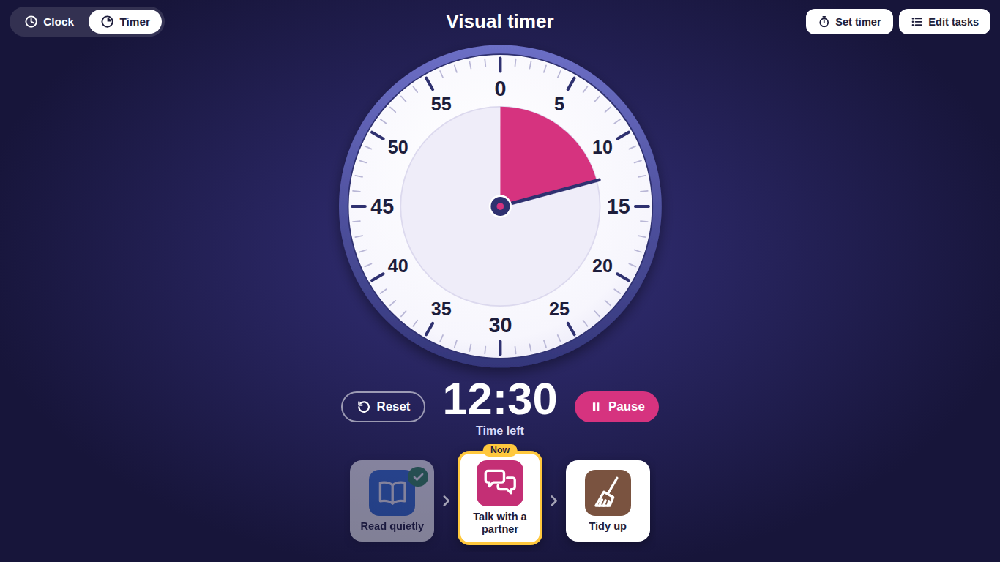
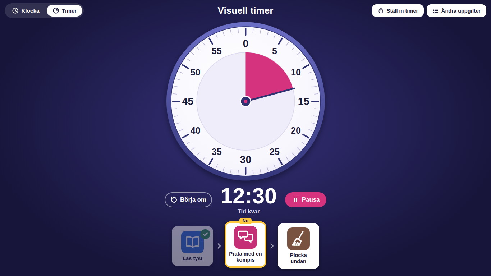

# Learn to Tell the Time

A free classroom tool that helps students learn to tell the time.

It has two views, and teachers can switch between them with the tabs at the top:

* **Clock:** an analogue clock where each hand carries its own number, with the time in words underneath. The short hand shows the hour and the long hand shows the minutes, so students can read the hands, check the numbers and hear how the time is said, all at once.
* **Timer:** a visual countdown that students can see shrinking, with picture cards underneath showing what they should be doing.




## Why this exists

Reading an analogue clock is hard to learn because the hands do not tell you what they mean. The clock bridges that gap. Students see where each hand points, see the matching number right on the hand, and see the time written the way people say it, coloured to match the hands. Over time they rely on the numbers less, and teachers can switch the numbers off completely for practice.

The timer helps with the other side of time: how long is left. Many students cannot yet judge time from a clock, but they can see a slice getting smaller. Picture cards beneath it answer the question "what should I be doing now?" without anyone having to ask.

It was built for school classrooms: for display on classroom computers and Chromebooks, and for embedding in a Google Site.

## Features

### Clock

* A live analogue clock with hour, minute and second hands that move like a real clock.
* A number badge on the middle of the hour hand and the minute hand. The badges always read the right way up and never cover each other or the numbers on the face.
* **The time in words**, such as "It's quarter past three" or "Klockan är kvart över tre". The minutes part is pink and the hour is purple, matching the hands.
* **A dashed ring for the next hour.** After half past, people name the hour that is coming ("quarter to eight") while the hour hand has only passed 7. Whenever the words do this, a dashed purple ring circles that number on the clock face, and the word gets a matching dashed underline. Solid purple is the hour we are in; dashed purple is the hour we are heading to.
* **A read-aloud button** that says the time using the voices built into the device. It only appears when the device has a voice for the page's language.
* A colour key and two short instructions, in high contrast colours that are easy to read from across a room.

### Timer

* A 60 minute dial. The pink slice is the time left: its edge points at the number of minutes remaining, and it shrinks back to 0.
* A large countdown with Start, Pause and Reset buttons.
* Quick picks (1, 2, 3, 5, 10, 15, 20, 30, 45 and 60 minutes) or any custom time up to 60 minutes.
* A gentle chime when time is up, made by the browser itself, with an option to turn it off.
* The screen is kept awake while the timer runs, where the browser allows it.
* The timer keeps running if you switch to the Clock view. The Timer tab shows the time left, and flashes when time is up.

### Task cards

* 16 premade symbol cards, each with a ready-made instruction, covering common classroom activities such as reading, writing, maths, partner talk, group work, tidy up and snack time.
* Teachers tap a card to add it, and can change the words, reorder the cards or remove them.
* The cards appear under the timer. The current task is highlighted as "Now", and tapping a card ticks it off so the next one lights up.
* Tasks can be added and changed while the timer is running.

### Everywhere

* English and Swedish versions.
* One single HTML file per language with no dependencies. No web fonts, no libraries, no images and no internet connection needed.
* **Locked down:** a strict security policy means no outside code can run and the page cannot connect to the internet. See [Security and privacy](#security-and-privacy).
* Fills any screen, from a small embed to a large display.
* Screen reader and keyboard support.

## Languages

| Language | File | Notes |
| --- | --- | --- |
| English | `index.html` | The main version |
| Swedish | `sv/index.html` | "Lär dig klockan!" |

Both files contain exactly the same code. The only difference is the `lang` attribute on the first line (`lang="en"` or `lang="sv"`), which tells the page which words to use.

<details>
<summary>See the Swedish version</summary>




</details>

## Quick start

1. Download or clone this repository.
2. Open `index.html` (or `sv/index.html`) in any web browser.

That is all. Nothing to install.

## Using the timer

1. Select the **Timer** tab.
2. Select **Set timer**, pick a quick time or type your own, then select **Start timer**.
3. To add tasks, select **Edit tasks** and tap the cards you want. Change the words if you like.
4. Close the panel. Students now see the timer with the task cards underneath.
5. Tap a task card when it is finished to tick it off.

Nothing is saved, so every session starts fresh. The premade cards mean a new list only takes a few taps.

To open the page straight onto the timer, add `#timer` to the end of the link, for example `https://<your-username>.github.io/<repository-name>/#timer`.

## Adding it to a Google Site

1. Open the file in a plain text editor (such as Notepad, TextEdit or VS Code) and copy everything.
2. In Google Sites, choose **Insert**, then **Embed**, then the **Embed code** tab.
3. Paste the code and select **Next**, then **Insert**.
4. Drag the edges of the embed box to make it as large as you like. A taller box gives a bigger clock and timer.
5. Open the published page and check the clock starts. If it does not, see the Google Sites note in [SECURITY.md](SECURITY.md).

## Hosting it with GitHub Pages

GitHub can host the page for free, giving you a link to use anywhere.

1. Open your copy of the repository on GitHub and go to **Settings**, then **Pages**.
2. Under **Build and deployment**, choose **Deploy from a branch**, pick your main branch and the `/ (root)` folder, then save.
3. Tick **Enforce HTTPS**.
4. After a minute or two the page will be live at:
   * English: `https://<your-username>.github.io/<repository-name>/`
   * Swedish: `https://<your-username>.github.io/<repository-name>/sv/`

## Settings for teachers

Every setting lives in one place: the **SETTINGS** block near the top of each file. It looks like this:

```json
{
  "showSecondHand": true,
  "showNumbersOnHands": true,
  "showTimeInWords": true,
  "showReadAloudButton": true,
  "startView": "clock",
  "defaultTimerMinutes": 10,
  "chime": true,
  "colours": {
    "hourHand": "#4b4e9c",
    "minuteHand": "#d6337f",
    "secondHand": "#e63946",
    "nowHighlight": "#ffc83d"
  }
}
```

Change the value after a colon and keep the quotes, colons and commas exactly as they are. Settings are data rather than code, so changing them never breaks the page's security. If a value is mistyped, that setting simply uses its default.

* **Practice mode:** set `showNumbersOnHands` to `false`. The badges disappear, so students have to read the hands on their own.
* **Words on or off:** `showTimeInWords` shows or hides the time in words, and `showReadAloudButton` shows or hides the speaker button.
* **Calmer clock:** set `showSecondHand` to `false` if the moving red hand distracts younger students.
* **Timer first:** set `startView` to `"timer"` if a classroom mostly uses the timer.
* **Colours:** use any colour, such as `"#2e7d32"` or `"darkgreen"`. The hand, its badge, its words and the colour key all update together. If you change a hand colour, update the colour word in the clock instructions too (for example "short purple hand").

To keep the repository tidy, make the same settings change in both language files.

## Security and privacy

* The page collects nothing: no accounts, no cookies, no saved data and no analytics.
* It cannot connect to the internet. This is enforced by the browser through the page's security policy.
* Only the code in the file itself can run, and words typed by teachers can never become code.
* If someone changes the code without updating its security fingerprints, the browser refuses to run it and the page says so clearly.

Full details, hosting advice and how to report a problem are in [SECURITY.md](SECURITY.md).

**If you change the CSS or JavaScript** (not the settings), run this from the repository folder before using or committing the file:

```
python3 tools/update-csp.py
```

On Windows use `py tools\update-csp.py`. It needs nothing beyond Python itself.

## Adding another language

1. In the script's `TEXT` section, copy the whole `sv: { ... }` block, rename it to the new language code (for example `de` for German), and translate every line.
2. In the `SYMBOLS` section, add a translation to each card next to `en` and `sv`, for example `de: "Leise lesen"`.
3. For the time in words, add the number words to `NUMBER_WORDS` and a rule to `WORD_RULES` that follows how that language says the time. This step is optional: without it, the words line is simply hidden.
4. Add a translated `<span lang="de">` line to the "could not start" message near the top of the page body.
5. Copy `index.html` into a new folder named after the language code (for example `de/index.html`) and change `lang="en"` on the first line to the new code.
6. Copy the updated code into the other language files too, so every file stays identical, then run `python3 tools/update-csp.py`.
7. Add the new language to the table in this README.

Contributions of new languages are very welcome.

## A note for Swedish classrooms

Spoken Swedish counts half hours towards the next hour. At 2:30 children say "halv tre", but the hour badge shows 2, because that is the hour the short hand has passed. The clock shows both: the words say "halv tre", and a dashed ring circles the 3 on the face, so students can see which hour the words are pointing to. The same happens in English after half past ("quarter to eight"). It is still worth talking through the idea in class.

## How it works

For anyone curious about the code, each file is laid out in clearly labelled parts:

* **SETTINGS:** plain data at the top, safe for teachers to change.
* **Part A (CSS):** colours, layout, the clock, the timer, the task cards and the teacher panel.
* **Part B (HTML):** the header tabs, the clock view, the timer view and the teacher panel. The clock and the timer dial are drawn as SVG on a 500 by 500 grid with the centre at (250, 250). The browser scales that grid to fit the screen, so every position is exact on any display.
* **Part C (JavaScript):** reading the settings, the words for each language, the symbol cards, the security doorway for markup, the time in words, and the code that moves the clock hands, runs the timer and manages the tasks.

A few details that keep it reliable on school devices:

* The clock lines up each tick with the start of a real second, so it never drifts.
* The timer stores the moment it should finish rather than counting down step by step, so it stays exact even if a Chromebook is slow or the tab is hidden.
* Both catch up straight away after a device wakes from sleep.
* The finish chime is scheduled for the exact end time, so it still sounds on time if the teacher has switched to another browser tab.
* While the timer runs, the page asks the browser to keep the screen awake. A page embedded inside another site, such as a Google Site, may not be allowed to do this, so check the screen sleep settings on those devices.

The code is commented throughout, so it is a good file to learn from.

## Browser support

Works in all current versions of Chrome (including ChromeOS), Edge, Firefox and Safari. A few extras (such as Trusted Types and keeping the screen awake) are used where the browser supports them, and are skipped safely where it does not.

## Contributing

Ideas, bug reports and improvements are welcome. Please open an issue or a pull request. For security problems, please follow [SECURITY.md](SECURITY.md) instead of opening a public issue.

To keep the tool easy for schools to use, contributions should:

* keep each language in a single HTML file, with identical code in every language file
* add no outside dependencies (no web fonts, libraries or images loaded from the internet)
* keep text large, clear and high contrast
* run `python3 tools/update-csp.py` after changing code (the **Security check** on each pull request confirms this)

## License

Released under the [MIT License](LICENSE). You are free to use, change and share this tool, including in your own school or project.
